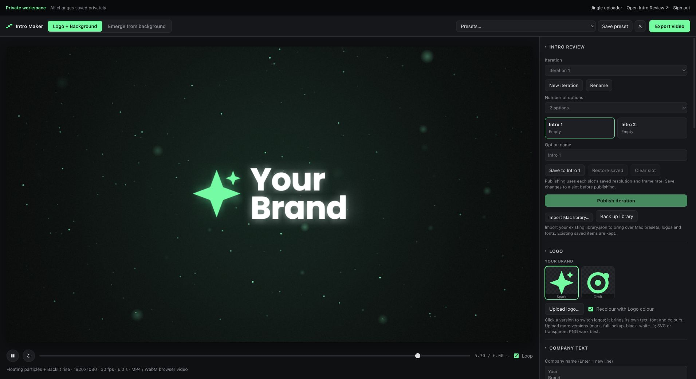

# Intro Maker

A self-hosted logo animation editor with a public client review board and a private jingle uploader. Create animated intros, save presets and review iterations, publish selected recordings, and collect feedback in one place.

The complete application runs on your machine with **Node.js 22 or newer**. It includes its JavaScript, fonts, sample logos, sign-in pages, and disk storage. There are **no npm dependencies, cloud accounts, API keys, or external runtime services**.



## Quick start

Install [Node.js](https://nodejs.org/) 22 or newer, then clone this repository (or download and extract its ZIP):

```sh
git clone https://github.com/calbogdanov-dotcom/intro-maker.git
cd intro-maker
npm run setup
npm start
```

Open the newly created `.env` file to read your generated username and password. Setup preserves an existing `.env`. No `npm install` is needed.

- Editor: **http://localhost:8787/maker/**
- Jingle uploader: **http://localhost:8787/jingles/**
- Review board: **http://localhost:8787/**

Use `localhost` exactly: the server checks the configured host. The board starts empty. The editor and uploader require owner sign-in; the public board has no editor or uploader link.

## Create and review

1. Open the editor, choose a bundled sample or upload your own SVG/PNG logo, then adjust text, animation, colors, timing, and output settings.
2. Save reusable presets. In the review panel, select an iteration and 2, 4, or 8 slots, and save the current intro to a slot.
3. **Publish iteration** records the saved slots in your browser and makes those recordings available on the review board. Autosaving and uploading alone keep work private.
4. Use the jingle uploader to upload audio options, then publish its iteration separately.
5. Share the board URL or an individual `/intro/{iteration}/{slot}` or `/jingle/{iteration}/{slot}` URL with reviewers.

Reviewers can choose a favorite, give thumbs up/down, and leave comments. Comments remain attached to their iteration and slot when recordings are replaced. Reviewers can remove feedback from the same browser using its saved receipt; the signed-in owner can moderate comments. Logo and audio records remain independent.

Browser exports use MP4 or WebM according to browser support. Recording happens in real time, so keep the tab open. A capable computer is needed for high resolution/frame rates. The portable web package does not include the separate native macOS ProRes exporter. Audio playback depends on browser codecs; MP3 is the most compatible choice. Audio uploads are limited to 40 MiB; intro recording uploads to 96,000,000 bytes.

## Configuration

`npm run setup` creates `.env`, which stays out of Git. Environment variables supplied by your host take precedence over `.env`.

| Variable | Default | Purpose |
| --- | --- | --- |
| `INTRO_MAKER_USERNAME` | `owner` | Owner sign-in name |
| `INTRO_MAKER_PASSWORD` | Required; setup generates one | At least 12 characters; use a long random password |
| `INTRO_MAKER_ORIGIN` | `http://localhost:8787` | Exact browser-facing origin, with no path |
| `HOST` | `127.0.0.1` | Network interface to listen on |
| `PORT` | `8787` | Local listening port |
| `INTRO_MAKER_DATA_DIR` | `data` | Private storage directory; relative paths resolve from the project root |

Sessions last 24 hours. Changing the username or password invalidates existing sessions. Sign out from the private workspace to clear this browser's session.

To change the review heading, edit `review/index.html` and the page title strings in `review/app.js`. To change the sample logos or default look, edit the built-ins in `maker/app.js` and `maker/assets/`. Restart `npm start` to rebuild.

## Run with Docker

```sh
npm run setup
docker build -t intro-maker .
docker volume create intro-maker-data
docker run --rm --name intro-maker -p 127.0.0.1:8787:8787 --env-file .env -e HOST=0.0.0.0 -v intro-maker-data:/app/data intro-maker
```

The image uses the same owner credentials from `.env`; it never copies that file into the image. The named volume preserves uploads and settings after the container exits. Docker is optional.

## Share a hosted instance

Localhost is accessible only on your machine. To let clients review remotely, run one Node process on a server behind an HTTPS reverse proxy, or run the Docker image on a host with persistent storage.

Set `INTRO_MAKER_ORIGIN=https://your-domain.example`, set `HOST=0.0.0.0` when the proxy needs network access, and preserve the original `Host` header in the proxy. Forward requests to the configured `PORT`. The server deliberately ignores forwarded identity, IP, and protocol headers. HTTPS origins use Secure, HttpOnly session cookies. Configure proxy body limits to allow the upload limits above.

Keep `data/` and `.env` private and outside any public static directory. Route all pages, assets, and APIs through `server/index.mjs`; serving the raw source or generated Worker module directly bypasses the Node deployment model. The generated Worker fails closed when no trusted authorization callback is present. This distribution needs no ChatGPT or Sites identity headers.

**Use one server process per data directory.** Disk storage uses atomic writes and revision checks within that process. Do not use clustering, multiple replicas, or shared-volume concurrent servers. For a large multi-instance service, supply a transactional shared storage adapter and an appropriate authentication deployment.

The review board and its published recordings, audio, and feedback are public to anyone who can reach the server. Private presets, draft settings, and unpublished uploads require owner authorization. The legacy service publishing endpoints are disabled in the standalone server.

## Backups and updates

Stop the server and copy the entire `data/` directory plus `.env` to a private backup. Restore both before starting a replacement instance. For Docker, back up the named volume instead of the project's local `data/`.

Update the source, retain your data and credentials, then restart. Builds replace only `dist/`. Do not include `.env`, `data/`, customer uploads, or exported recordings in a fork or pull request.

## Development and verification

```sh
npm test
npm run validate
```

Tests cover owner authorization, draft privacy, publishing, persistent disk storage, revision conflicts, byte-range media playback, feedback and removal receipts, synchronized gallery playback, companion audio, and recording settings. GitHub Actions runs the same checks on Node 22 and 24 across Linux, macOS, and Windows.

| Directory | Contents |
| --- | --- |
| `maker/` | Version 1 editor and canvas animation renderer |
| `review/` | Public board and individual feedback views |
| `jingles/` | Private audio uploader |
| `worker/` | Shared request handlers and publication/storage rules |
| `server/` | Node HTTP adapter, owner sessions, and disk-backed object store |
| `scripts/` | Setup, build, and behavior checks |
| `tests/` | Standalone server and storage integration tests |

`npm start` builds automatically. `npm run build` embeds UI assets into `dist/server/index.js`. No user data or hosting account identity is part of the build.

## License

[MIT](LICENSE). Poppins is bundled under the [SIL Open Font License 1.1](maker/assets/fonts/OFL.txt). See [third-party notices](THIRD_PARTY_NOTICES.md). Generic sample artwork is included; client artwork, live-site configuration, private libraries, and customer recordings are not.
